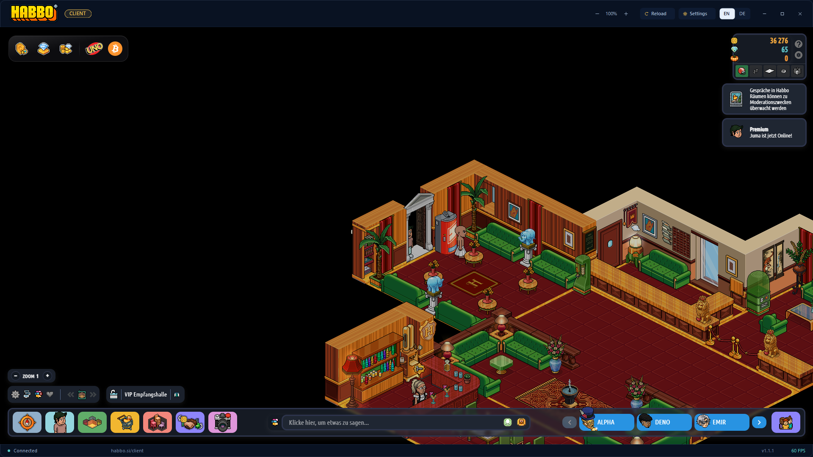

# Habbo.si Client

A lightweight Windows desktop client for **[habbo.si](https://habbo.si/client)**, built on the
interface of Habbo Badge Creator. One small `.exe` and three WebView2 files — the hotel itself
runs in the Microsoft Edge WebView2 engine that already ships with Windows, so nothing is
bundled, nothing is downloaded and there is no installer.



The hotel's own web client sits in the middle; the surrounding chrome is the original flat
material shell: borderless rounded window, app bar with the HABBO wordmark, gold theme accent,
custom caption buttons, a status/FPS footer and themed sheets.

## What it is (and is not)

- It is a **shell**: it opens `https://habbo.si/client` in a real Chromium context, inside a window
  that looks and behaves like a game client.
- It is **not** a replacement client, emulator or server. Login, single sign-on, assets, rooms and
  the websocket all stay on habbo.si. The client never asks for your credentials and stores none
  itself — the session lives in the WebView2 profile the hotel set.
- It is not affiliated with Habbo, Sulake or habbo.si.

## Requirements

- **Windows 10 1903+ or Windows 11** (.NET Framework 4.8 is part of both).
- **Microsoft Edge WebView2 Runtime.** Windows 11 and current Windows 10 builds already have it;
  if it is missing the client says so and links to the download page. No admin rights needed to
  run the app itself.
- No installer: copy the `dist` folder anywhere and run `Habbo.si Client.exe`.

## Build

Only the C# compiler that ships with Windows is used — no SDK, no NuGet, no toolchain install.
The WebView2 SDK is vendored in `lib/webview2`.

```
build.bat
```

or, from Git Bash / MSYS:

```
./build.sh
```

Output: `dist/Habbo.si Client.exe` plus the three WebView2 files it needs beside it
(`Microsoft.Web.WebView2.Core.dll`, `Microsoft.Web.WebView2.WinForms.dll`, `WebView2Loader.dll`).
The build copies them automatically — keep the four files together.

## First start

The client opens `https://habbo.si/client`. A fresh WebView2 profile has no session, so the
hotel shows its **login page**; sign in there and the client loads the hotel. Username/password
and the Discord button both work inside the window, and the session is kept in the client's own
profile, so the next launch goes straight to the hotel. `Settings → Clear cache` removes that
session if you want to switch accounts.

## Features

- **The hotel, accelerated** — Edge WebView2 with GPU rasterisation and zero-copy enabled, a
  persisted profile (login, `localStorage`, asset cache) and no bundled browser.
- **No background throttling** — when the window is covered, Chromium normally throttles timers and
  renderers; the client turns that off so the hotel keeps its connection and animations alive.
- **FPS readout** — a one-line `requestAnimationFrame` counter is installed before the hotel's
  scripts, polled once a second and shown in the footer (teal at 60+, muted below).
- **Session reload** — `F5` reloads the client without touching your window size or zoom.
- **Zoom** — `−` / `+` in the app bar or `Ctrl` `+` / `−` / `0`; 50 %–200 %, remembered.
- **Fullscreen** — `F11` (or `Esc` to leave) drops the chrome for a clean client surface.
- **Themes** — dark, light and navy palettes for the chrome, chosen in Settings and previewed live.
- **Themed sheets** — Settings and the delete/confirm/notice sheets are drawn in the app's palette,
  never in stock Windows grey; they fade in and out.
- **External links open in your browser** — Discord, help pages and anything outside `habbo.si`
  leaves the client instead of hijacking it.
- **Discord Rich Presence** — the big `logo` artwork, **Habbo.si Client v1.1.1 — Game Client** as its hover text,
  and the room you are in as the activity line. Needs your own Discord application ID (below).
- **Window state** — size, maximised state, theme, zoom and language are stored in
  `%LOCALAPPDATA%\HabboSiClient\settings.json`.
- **English / German** chrome via the `EN | DE` switch.

## Keyboard

| Key | Action |
| --- | --- |
| `F5` | Reload the hotel |
| `F11` | Fullscreen on / off |
| `Esc` | Leave fullscreen |
| `F12` | DevTools (switch it on in Settings first) |
| `Ctrl` `+` / `Ctrl` `−` / `Ctrl` `0` | Zoom in / out / reset |

## Settings

`Settings` in the app bar opens the themed sheet:

- **Appearance** — dark, light, navy. The sheet and the window behind it preview the palette;
  Cancel restores the previous one.
- **Performance** — hardware acceleration and “keep running in the background” are renderer
  switches and need a restart (the sheet marks them). Show FPS and developer tools apply at once.
- **Profile** — open the WebView2 profile folder, or clear cached assets and the saved session.
- **Discord** — Rich Presence on/off and the application ID. The dot shows whether the local
  Discord client is connected; the room line updates on its own.

## Discord Rich Presence

Discord only displays an application it knows, so the client needs a **Discord application ID**
from an app you control (it cannot ship someone else's):

1. Open <https://discord.com/developers/applications> → **New Application** and name it
   `HabboSI Client`.
2. **Rich Presence → Art Assets** → upload a 1024 × 1024 icon and set its asset key to `logo`.
   That key is what the client sends as the big image.
3. Copy the **Application ID** and paste it into *Settings → Discord*. The dot turns gold once the
   local Discord client answers.

The activity shows the big artwork with **Habbo.si Client v1.1.1 — Game Client** on hover, and the line under it
names the current room (`In Sunset Lounge`, or `In the hotel` before you enter one). Room names are
read from the hotel client's room header and its page title, including inside frames; if the hotel
exposes the room nowhere readable, the line stays on `In the hotel`.

Presence talks to the installed Discord client over the local `\\.\pipe\discord-ipc-0…9` pipe.
Nothing is uploaded, no token or password is read, and presence stops when the client closes.
A publisher can bake an ID into `DiscordRpc.BuiltInAppId` so users do not have to paste one.

## Data

```
%LOCALAPPDATA%\HabboSiClient\
├─ settings.json      theme, language, zoom, renderer switches, window size
└─ WebView2\          Chromium profile: hotel login, localStorage, cached assets
```

Delete that folder to reset the client completely. Nothing is uploaded by the client; the hotel's
own connections are the only network traffic.

## Where the interface came from

The chrome is the interface of **[Habbo Badge Creator](https://github.com/jumayusiii/Habbo-Badge-Creator-Beta)**
by Jumayusi (source published for transparency, all rights reserved). The badge editor itself has
been removed: no pixel document, layers, palette, exporters, GIF writer or changelog remains. What
is kept is the UI layer — `Theme.cs` (palettes, fonts, GDI+ helpers, vector icons), the controls in
`Controls.cs`, the themed message sheet, the splash and the window chrome. The old Discord IPC
client is reused, but retargeted at the hotel. `LICENSE` is the original licence and applies to
that UI code.

## Layout

| Path | Purpose |
| --- | --- |
| `src/ClientForm.cs` | window chrome, app bar, footer, keyboard, WebView2 host |
| `src/SettingsSheet.cs` | themed settings: appearance, renderer switches, profile tools |
| `src/Discord.cs` | Discord IPC client: handshake, activity frames, large-text tooltip |
| `src/FieldBox.cs` | themed single-line input used by the settings sheet |
| `src/Theme.cs` | dark / light / navy palettes, fonts, GDI+ primitives, icon set |
| `src/Controls.cs` | buttons, chips, caption buttons, language switch, theme tile, toggle row |
| `src/MessageSheet.cs` | themed confirm / notice sheet, shared by every dialog |
| `src/Settings.cs` | settings model and the JSON store in `%LOCALAPPDATA%` |
| `src/Edge.cs` | WebView2 environment options and Chromium switches |
| `src/Program.cs` | entry point, DPI, theme bootstrap, splash, `--shot` / `--smoke` |
| `src/Splash.cs` | startup splash |
| `lib/webview2/` | vendored WebView2 SDK and loader DLLs |
| `assets/` | app icon and the HABBO wordmark |
| `tools/MakeIcon.cs` | regenerates `assets/habbo.ico` from `assets/logo.png` |

### Developer flags

```
"dist\Habbo.si Client.exe" --shot ui.png            # render the chrome to a PNG (no hotel)
"dist\Habbo.si Client.exe" --smoke smoke.log --smoke-shot page.png
                                                    # real navigation + capture, then exit
"dist\Habbo.si Client.exe" --shot-live docs/client.png
                                                    # window capture with the hotel inside
"dist\Habbo.si Client.exe" --presence-json presence.json
                                                    # write the SET_ACTIVITY payload and exit
"distHabbo.si Client.exe" --probe room.json           # dump room/DOM diagnostics
"dist\Habbo.si Client.exe" --theme light --nosplash # light chrome
"dist\Habbo.si Client.exe" --lang de                # German chrome
"dist\Habbo.si Client.exe" --scale 1.5              # fake a 150% layout
```

`--smoke` writes the runtime version, navigation result, HTTP status, final URL, elapsed
milliseconds, page title and FPS, then captures the web content with `CapturePreviewAsync`.

## Licence and trademarks

The interface code is © 2026 Jumayusi and carries the terms in [LICENSE](LICENSE). Habbo.si Client
is a fan-made wrapper, not affiliated with, endorsed by or sponsored by Habbo, Sulake or habbo.si.
HABBO and the Habbo logo are trademarks of Sulake Corporation Oy.
